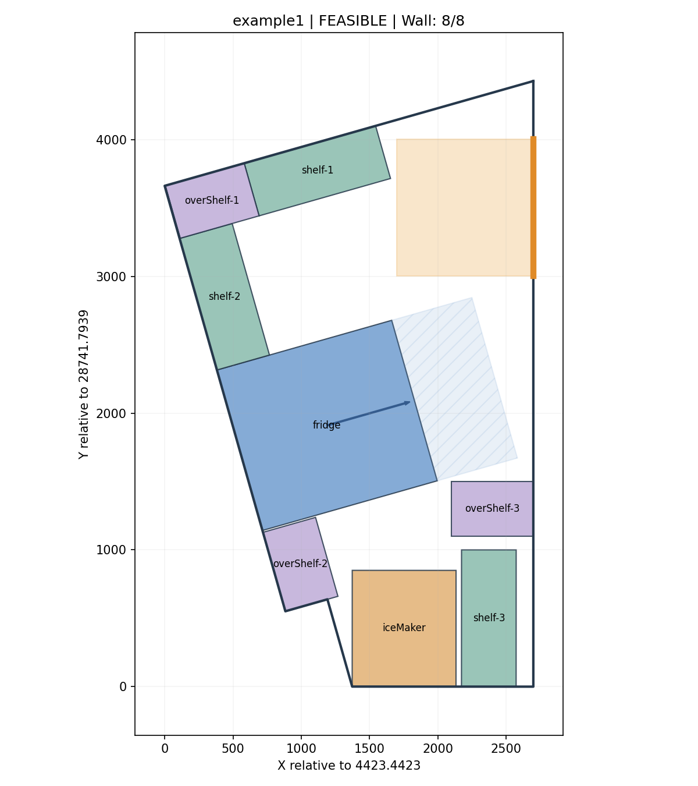
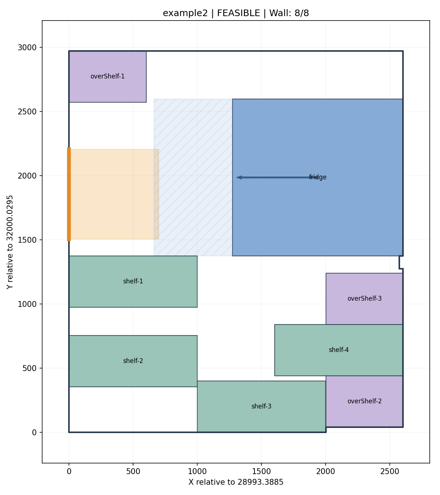
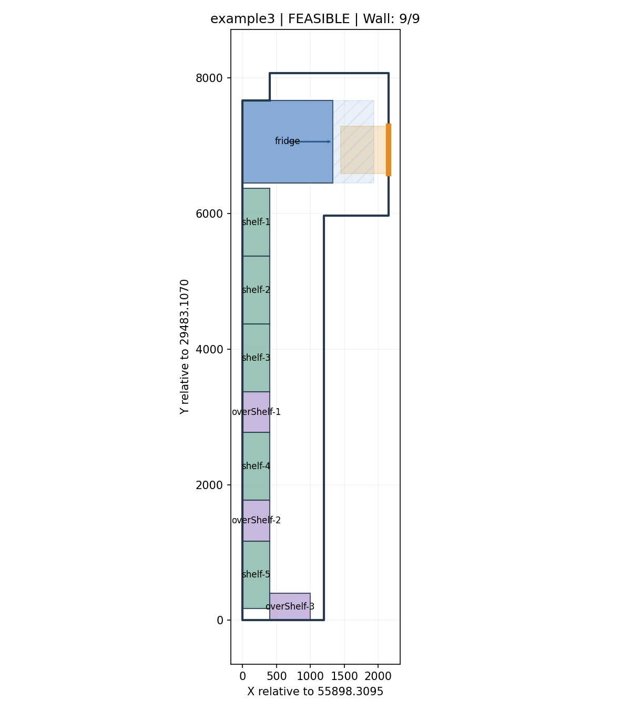
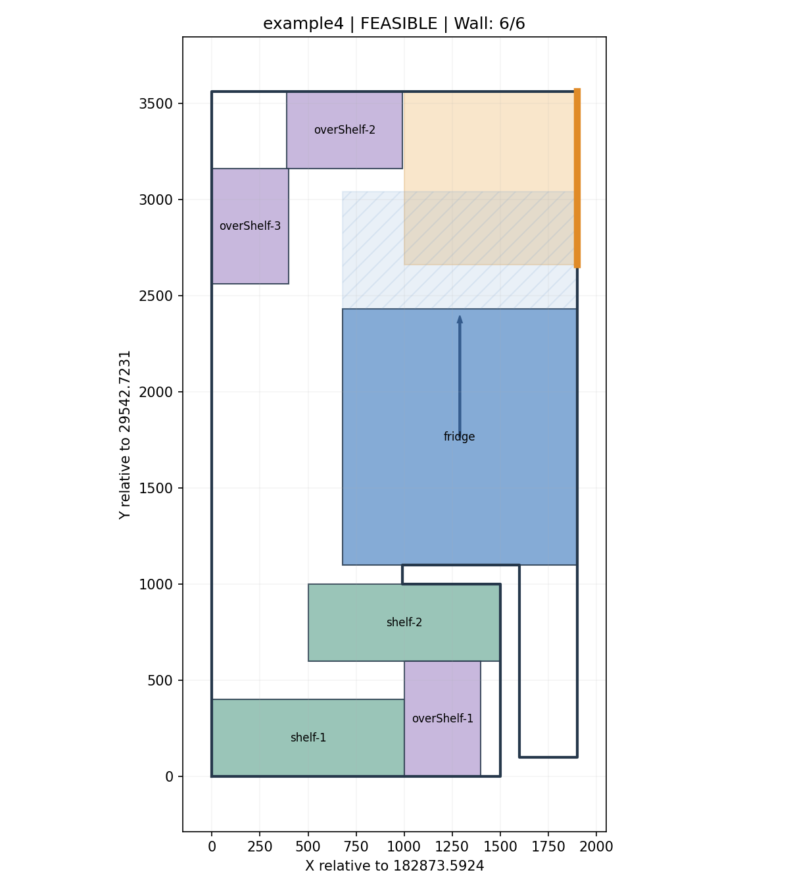

# 不规则轮廓内设备自动摆放

Python 实现：读取房间轮廓、门和矩形设备尺寸，输出是否找到可行方案、每件设备的中心坐标与旋转角度，并生成平面图。支持凹多边形、斜墙、90°方向切换、冰箱开门净空及贴墙优先。

## 1. 核心逻辑与 AI 使用说明

本交付使用 **ChatGPT / Codex** 辅助完成题意拆解、算法设计、代码生成、调试、测试和 README 编写。没有使用人工编造的实验结果。

**提交者本人理解和调整的部分：** 本人理解及调整的关键逻辑主要为以下几点：

1. 关于一些约束规则的细化，如没有明确的冰箱正面及其禁区规则、矩形接触的最小距离限制（是否允许紧贴）、外开门是否需要考虑其禁区等，以上均调整可开放用户调整的参数约束；
2. 对于部分轮廓线输入不规则的情况，调整为只要满足封闭图形结构即可；
3. 对于求解寻优算法，确定了采用 “墙面优先候选生成 + DFS 回溯搜索 + 多次重启” 的策略，并留下了后续进行软约束优化的空间，如预留员工通行通道，空间整齐度等其他优化方向，具体方向后续版本代码可继续更新；
4. 本寻优算法并未严谨证明 “无可行解”，只是在有限的算力资源及合适的步长约束下的子空间中寻找可行解。这样考虑是因为————样例对应的实际工业场景中，物品占地面积相较于可用放置面积的比例低于50%，更有可能存在简单的可行解（可进一步探索）；同时，正方形堆积（在一个大正方形中）问题是数学界至今仍未解决的问题，在此题目中，更是泛化到了矩形的范围，边界不规则的情况。因此，本算法暂未考虑全局是否存在可行解；
5. 还调整了一部分中间过程的输出，方便用户可视化效果，如最终结果的可视化图像等，后续可进一步输出其他优化目标的偏好方案供挑选。

### 几何建模

- 所有坐标、长宽、净空和步长使用输入的同一种单位。示例量级按毫米理解；程序不自动换算。
- 初始角度 0°：`length` 沿世界 X 正方向，`width` 沿世界 Y 正方向；角度为绕物品中心逆时针旋转。
- 冰箱开门边取局部 `y = -width/2`，其边长为 `length`。角度同时描述物体朝向和开门朝向，因此冰箱区分 0/180°、90/270°。
- 允许沿任一轮廓边平行或垂直摆放，并非要求矩形与所有斜墙同时平行。保留输入真实斜率，不把近似水平墙强行吸附到水平。
- 使用 Shapely 多边形覆盖与相交检测，不仅检查矩形中心或四角，避免矩形跨过凹口。
- 接触墙边、物品边允许；内部重叠禁止。几何运算有尺度相关浮点容差，见 `Problem.tol`；这不是施工预留间距。
- 先将坐标平移到局部原点，输出恢复原始世界坐标。结果保留浮点精度，不建议将结果随意舍入后直接施工。

### 轮廓与输入检查

`example4.json` 的末端重复走过左侧边界，原始 Polygon 无效。程序将轮廓线段打断、去重并提取封闭面；**仅在恰好一个封闭面且面积不变时接受规范化**，输出包含警告。自交形成多个面的轮廓会报错，不静默猜测房间。输入文件本身保持原样。

检查门是否位于轮廓边界、尺寸是否为正且有限、内开门保留方形是否完整位于房间内。

### 候选生成

1. 沿各墙边建立切向量 `u` 和指向室内的法向量 `v`。
2. 对每种朝向，沿墙放置矩形中心 `p + (t + along/2)u + (deep/2)v`。
3. 沿墙位置同时包括墙端点、轮廓顶点投影锚点和固定步长采样。
4. 剔除越界、遮门及冰箱开门净空越界的候选。
5. 优先仅使用贴墙候选求解；失败后在墙方向坐标系内加入室内网格候选。

### 冲突图与搜索

每个候选摆放是一个节点；实体之间相交，或某实体进入另一冰箱的开门净空时，两个节点冲突。STRtree 先筛选可能冲突的几何对，再做几何检测。用 Python 整数位集记录冲突集合。

把类型、尺寸、净空相同的物品合为一个组，要求选择该组数量对应的候选。回溯时优先选择“剩余候选数 / 未放数量”最小的组（MRV），放置后剔除所有冲突候选。相同物品只按候选 ID 递增选择，消除物品交换带来的重复搜索。

不是逐件不可撤销的贪心：后续失败会回溯前面的选择。

### 可行性与最优性的准确含义

| 字段 | 含义 |
|---|---|
| `status = FEASIBLE`, `feasible = true` | 找到并验证完整摆放方案 |
| `status = INFEASIBLE`, `feasible = false` | 当前模型下，设备面积大于可用面积，有严格面积下界证明 |
| `status = UNKNOWN`, `feasible = null` | 离散候选或时间预算内未找到；不能断言连续问题无解 |
| 输入错误 / 退出码 2 | 非法几何或参数，需要修正输入 |
| `wall_count_optimal = true` | 全部物品贴墙，贴墙件数已经达到 K 的理论上限 |

有限采样不是连续完备算法。即使穷尽所有候选仍无解，也不输出“已证明不可行”。室内候选阶段优先尝试贴墙节点，但不保证得到最大贴墙件数；当前四个示例均达到全部贴墙，因此这一点不影响示例的贴墙件数最优性。没有优化视觉美观度、过道宽度或总接触长度。

冲突图最坏 O(C²) 时间/位集规模，回溯最坏指数复杂度。适合当前几件至十几件的练习规模，不承诺大规模实时性能。

## 2. 明确的题意假设

题目未给出所有设备功能参数，因此将缺失条件与硬约束分开：

| 条件 | 当前处理 |
|---|---|
| 内开门 | 门宽 N 决定 N×N 保留区；采用题目主描述，不固定为“1×1” |
| 外开门 | 不模拟室内门扇；默认仍预留宽 N、深 N 的入口空闲区，较题目更保守。可设置 `doorAccessDepth` 调整，设为 0 则仅检查门线不能被设备占据 |
| 冰箱开门深度 | 默认 `length / 2`，是参考双门形态作出的建模假设，并非题面或厂商规定；可用顶层 `fridgeClearance` 覆盖 |
| 冰箱净空与入口保留区 | 允许共享空闲区域，禁止设备实体占用；**不保证两扇门同时开启无碰撞**。示例 3 存在共享区域 |
| overShelf 离地架 | 输入只有二维尺寸，无标高/高度，因此作为同层实体处理，不允许与其他设备叠放 |
| shelf | 不额外要求开门净空，可与其他物体边缘接触 |
| iceMaker | 按给定实体尺寸处理，未假定检修/散热方向 |
| 可达性、消防、维护间距 | 本题几何模型未包含；可行结果不等于可直接施工的建筑方案 |

若更改默认净空，必须重新求解和验证。附图仅供理解背景，算法尺寸和轮廓以 JSON 为准；没有把图片中的尺寸标注、其他固定设施自动加入模型。

## 3. 环境与运行

已在 Python 3.12.14 环境执行验证。建议 Python 3.12；代码要求 Python 3.11+，其他版本需自行验证。

```bash
python -m venv .venv
# Windows PowerShell:
.venv\Scripts\Activate.ps1
# macOS/Linux:
source .venv/bin/activate
python -m pip install -r requirements.txt
```

运行单组示例：

```bash
python solver.py examples/example1.json --output results/example1.json --plot results/example1.png
```

运行全部四组：

```bash
python run_examples.py
```

运行测试及单独校验已保存结果：

```bash
python -m unittest discover -s tests -v
python solver.py examples/example1.json --validate results/example1.json
```

调整搜索精度：

```bash
python solver.py examples/example1.json --step 50 --seconds 30 --output refined.json --plot refined.png
```

`--step` 为墙边候选步长；室内网格默认采用其两倍。减小步长增加时间和内存开销，且不保证候选集合严格嵌套或一定找到解。`--seconds` 是**每阶段回溯**预算，不包括候选生成和冲突图构建，不是端到端时限。每个阶段在输出 `stages` 中记录候选数量、搜索节点数和计时；`elapsed_seconds` 包括该阶段冲突图构建与回溯，不包括候选生成、绘图和文件读写。

API：`solve(data, step=100, seconds=15, interior_step=None)`，返回 JSON 可序列化字典。

### 输入扩展

原始四份示例无需更改。可在顶层加入：

```json
{
  "fridgeClearance": 600,
  "doorAccessDepth": 800
}
```

上面仅展示可选字段，不是完整输入；完整结构见 `examples/`。`doorAccessDepth` 仅作用于外开门，内开门始终保留 N×N。物品名以 `fridge`、`shelf`、`overShelf`、`iceMaker` 开头，可用 `-1`、`-2` 区分多件；未知类型按普通矩形处理。

## 4. 既定输入的实测输出

默认参数 `step=100`、`seconds=15`，四组均在墙候选阶段找到完整解，输出重建后的几何校验通过。

| 输入 | 件数 | 贴墙数 | 状态 | 墙候选数 | 回溯节点 |
|---|---:|---:|---|---:|---:|
| example1 | 8 | 8 | FEASIBLE | 562 | 9 |
| example2 | 8 | 8 | FEASIBLE | 290 | 9 |
| example3 | 9 | 9 | FEASIBLE | 616 | 10 |
| example4 | 6 | 6 | FEASIBLE | 230 | 7 |

全部中心点和旋转角度见 `results/example1.json` 至 `example4.json`，可读表格见 [RESULTS.md](RESULTS.md)。`validation.passed` 表示输出坐标重建后通过约束校验，不是仅信任求解器内部候选。

图例：蓝色为冰箱、绿色为货架、紫色为离地架、土黄色为制冰机；蓝色斜线区为冰箱净空，箭头指向开门侧；橙色区域为门口保留区。图中显示平移后的坐标，JSON 使用原始绝对坐标。






## 5. 文件结构与提交

- `solver.py`：输入校验、几何建模、候选生成、冲突图、回溯、输出验证、绘图和命令行入口。
- `run_examples.py`：批量生成四组结果。
- `tests/test_solver.py`：15 项自动化测试，覆盖四例回归、斜墙、凹口、碰撞、门区、冰箱净空、非法输入、室内候选回退与 UNKNOWN 语义。
- `examples/`：原始输入 JSON。
- `results/`：实测输出 JSON 及 PNG。
- `RESULTS.md`：逐件中心点与角度表。
- `requirements.txt`：本次验证的依赖版本。
- `reference/`：用户提供的原始题目要求与参考图。
- `TEST_REPORT.txt`：实际测试运行记录。
